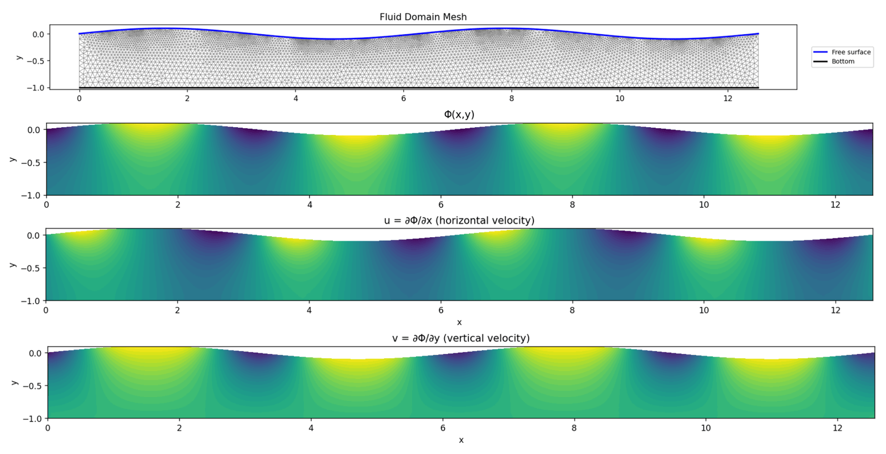

<!-- Author: Dr. Denys Dutykh (Mathematics Department, Khalifa University of Science and Technology, Abu Dhabi, UAE) -->

# FlowReconstruct: the potential flow under a periodic free surface, from the potential given on it



The mesh that `mesh_domain.py` builds under a free surface η(x) = 0.1 sin x of length 4π above a flat bottom at depth 1
(top), and the potential Φ and the velocity components u = ∂Φ/∂x and v = ∂Φ/∂y that `solve_laplace.py` computes on it,
for the trace φ(x) = sin²x − cos⁴x of the potential on the free surface, as the scripts draw them. In its present form
`solve_laplace.py` draws Φ and u_y − v_x; its plots of u and v are commented out.

FlowReconstruct is a set of three Python scripts that reconstruct the velocity potential Φ(x, y) of a two-dimensional
periodic wave tank from the shape of the free surface η(x) and the values φ(x) of the potential on it, both known at
scattered points, and return the velocity field, in particular on the free surface. The scripts mesh the fluid domain
with Gmsh and solve the Laplace equation by finite elements with the legacy FEniCS. They were written as a
post-processing tool for the spectral solvers of the full Euler equations, which advance the free surface and the
surface potential but do not give the flow beneath. No article accompanies the code, so the software itself is cited
(see How to cite).

## The problem

In the fluid domain 0 < x < L, −h0 < y < η(x), the potential Φ solves

```text
∂²Φ/∂x² + ∂²Φ/∂y² = 0      in the fluid,
Φ(x, η(x)) = φ(x)          on the free surface,
∂Φ/∂y = 0                  on the bottom y = −h0,
Φ periodic in x of period L,
```

and the velocity is (u, v) = (∂Φ/∂x, ∂Φ/∂y). Since the flow is irrotational, u_y − v_x vanishes; its computed values
measure the error of the discretisation.

The data are sorted in x, extended to x = 0 and x = L by cubic splines, and made periodic by giving both ends the mean
of their two values. The free surface of the mesh is the polygon through the data points, closed by the vertical sides
x = 0 and x = L and the bottom y = −h0; Gmsh meshes this domain with triangles of the requested size (0.1 by default)
and improves them with its Netgen optimiser. On this mesh, `solve_laplace.py` uses continuous Lagrange elements (of
degree 2 by default) constrained to be periodic in x, imposes the cubic spline of φ on the boundary facets that lie
within 10⁻³ of the spline of η, and leaves the homogeneous Neumann condition at the bottom to the weak form. The
velocity is the projection of ∇Φ on the same elements, and its values at the data points of the free surface are
written to two CSV files. Since the free surface passes through every data point, two close points make a short edge:
the mesh that `mesh_domain.py` builds from the shipped data, whose closest points are 7 × 10⁻⁶ apart, has edges from
7 × 10⁻⁶ to 0.13 and a smallest angle of 0.04°.

## The data

The script `generate_data.py` draws N points x uniformly at random in [0, L], sorts them, and evaluates two analytic
test fields there,

```text
η(x) = a sin x,        φ(x) = sin²x − cos⁴x,
```

which it writes, with L and h0, to `data/data.csv` (columns x, eta, phi, L, h0). They are not a sea state: data computed
by a spectral solver of the Euler equations take their place in an application. The options are

| Option | Meaning | Default |
|---|---|---|
| `-a`, `--amplitude` | amplitude a of η | 0.1 |
| `-L`, `--length` | length L of the tank | 4π |
| `-N`, `--num-samples` | number N of random points | 100 |
| `--h0` | undisturbed depth h0 (bottom at y = −h0) | 1.0 |
| `-o`, `--output-dir` | folder of `data.csv` | `data` |
| `--seed` | seed of the random generator | none |

The shipped file `data/data.csv` holds 500 points with a = 0.1, L = 4π and h0 = 1; the folders `mesh/` and `solution/`
hold its mesh and its solution.

## Quick start

From the root folder of the repository, the three steps are

```bash
python3 generate_data.py -N 500 --seed 1
python3 mesh_domain.py -i data/data.csv -m mesh/mesh.msh -x mesh/mesh.xdmf --mesh-size 0.1
python3 solve_laplace.py --mesh mesh/mesh.xdmf --data data/data.csv --degree 2 --output solution/solution.xdmf
```

The first writes new data over `data/data.csv` and draws them; it is skipped to keep the shipped data. The second
writes the mesh to `mesh/mesh.msh` and `mesh/mesh.xdmf` (with `mesh/mesh.h5`), draws it and prints its statistics
(numbers of nodes, edges and triangles, lengths, areas, aspect ratios and angles). The third writes the potential to
`solution/solution.xdmf`, the gradients of u and v to `solution/grad_u.xdmf` and `solution/grad_v.xdmf`, and the
velocities at the free-surface points to `solution/u_free_surface.csv` and `solution/v_free_surface.csv`; it draws Φ and
u_y − v_x and prints the largest value and the L² norm of u_y − v_x. Each figure opens in a window of Matplotlib.

## Contents

| File or folder | Contents |
|---|---|
| `generate_data.py` | the analytic test data at random points |
| `mesh_domain.py` | the periodic extension of η, the mesh of the fluid domain and its statistics |
| `solve_laplace.py` | the finite element solution of the Laplace equation, the velocities and the check u_y − v_x |
| `data/data.csv` | the shipped data (500 points) |
| `mesh/` | the mesh of the shipped data (Gmsh and XDMF) |
| `solution/` | the potential, the gradients of the velocity components and the free-surface velocities for the shipped data |
| `img/Illustration.png` | the figure at the top of this page |

## Requirements

Python 3.10 or later (`generate_data.py` writes its type hints with the union operator, `int | None`), NumPy, SciPy,
Matplotlib, and the Python modules of Gmsh (`gmsh`) and meshio for the first two scripts; `solve_laplace.py` needs in
addition the legacy FEniCS, the module `fenics` of FEniCS 2019 (not FEniCSx, whose module is `dolfinx`). The first two
scripts were checked with Python 3.14, gmsh 4.14 and meshio 5.3.

## How to cite

No article accompanies this code, so please cite the software itself:

D. Dutykh, FlowReconstruct: the potential flow under a periodic free surface, from the potential given on it, version
1.0.0 (2026).

https://github.com/dutykh/FlowReconstruct

```bibtex
@software{Dutykh_FlowReconstruct,
  author = {Dutykh, Denys},
  title = {{FlowReconstruct}: the potential flow under a periodic free surface, from the potential given on it},
  year = {2026},
  version = {1.0.0},
  url = {https://github.com/dutykh/FlowReconstruct},
  license = {LGPL-3.0-only}
}
```

The button "Cite this repository" in the right-hand column of this page gives the same reference, read from
`CITATION.cff`.

## Licence

GNU Lesser General Public License, version 3 (see `LICENSE`).

## Author

Denys Dutykh (Mathematics Department, Khalifa University of Science and Technology, Abu Dhabi, UAE).

https://www.denys-dutykh.com/

Special thanks to Professor Francesco Fedele (Georgia Institute of Technology, Atlanta, USA) for posing the questions
that led to this development.
